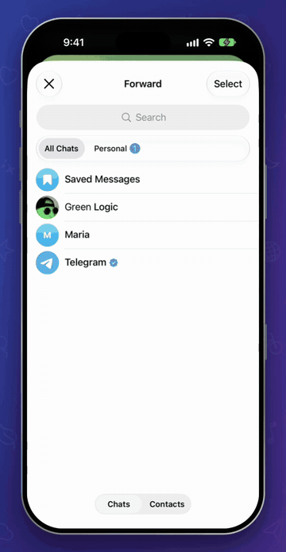
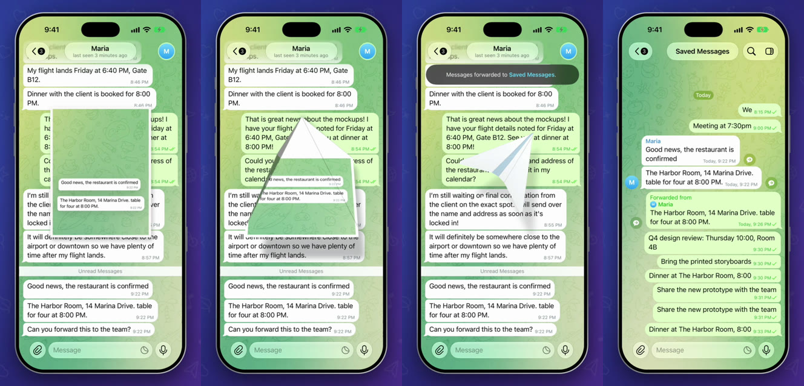

# Paper Plane Forward

Forwarding in Telegram ends with a small toast. Here the messages you picked lift off the chat, land on
a sheet of paper printed with your wallpaper, and fold into a plane in the shape of the Telegram logo. It
hovers for a moment, flies a loop with a dashed line behind it, and lands in the "Forwarded to…" toast.

Forward into the chat you're already in and the plane lands right there, and the message appears as it
touches down.

This is a patch for the real Telegram for iOS, not a mock-up. The video was recorded from the app built
with this code, on a real account.

<p align="center">
  
</p>

▶︎ [Media/demo.mp4](Media/demo.mp4) is the full video (20 seconds).



## Where each part is

Everything sits at the same path it has inside Telegram-iOS, so `submodules/` can be copied straight
over a checkout.

### New files

| Part | File | What it does |
|---|---|---|
| Folds and flight | [`PaperPlaneGeometry.swift`](submodules/TelegramUI/Components/Chat/PaperPlaneForward/Sources/PaperPlaneGeometry.swift) | The settings, the paper cut into facets, the four folds, the flight path and the mesh. Plain Swift and simd. |
| Drawing it | [`PaperPlaneForwardAnimator.swift`](submodules/TelegramUI/Components/Chat/PaperPlaneForward/Sources/PaperPlaneForwardAnimator.swift) | The public API, the timeline, the Metal renderer and shaders, the shadow and the dashed line. |
| Connecting it to a chat | [`ChatControllerPaperPlaneForward.swift`](submodules/TelegramUI/Sources/ChatControllerPaperPlaneForward.swift) | Snapshots the selected messages, cuts the paper from the wallpaper, picks the colors and where the plane lands. |
| Bazel target | [`BUILD`](submodules/TelegramUI/Components/Chat/PaperPlaneForward/BUILD) | The `PaperPlaneForward` module. |

### Changes to Telegram's own files

| Part | Patch | Files | What changes |
|---|---|---|---|
| The forward itself | [`01-forward-flow.patch`](patches/01-forward-flow.patch) | `ChatControllerForwardMessages.swift` | Starts the plane when you pick a chat, and holds a same-chat forward back until the plane has landed. |
| Bazel dependency | [`02-build-dependency.patch`](patches/02-build-dependency.patch) | `TelegramUI/BUILD` | Adds the new module to TelegramUI. |

## How it works

| Time | Phase | |
|---|---|---|
| 0.00 s | gather | Copies of the messages lift off and settle on the sheet. The originals stay, forwarding keeps them. |
| 0.50 s | fold | Corners, edges, in half, wings down. |
| 1.85 s | hold | The plane hovers while a glint crosses it. |
| 2.23 s | flight | Wind-up, launch, one loop, a dive into the landing spot. |
| 4.28 s | arrive | `onArrive` fires, the dashed line fades, then `onCompletion`. |

**Folding.** The sheet is cut along every crease into rigid convex facets (`PaperPlaneModel`). The first
two folds end flat, so they are 2D reflections plus stacking layers. The last two are nested rotations:
a wing turns in its half's frame, then the half turns about the spine. A depth buffer and 4x MSAA keep
the layers from fighting.

**The logo shape.** A real sheet folds into a long narrow dart. As the wings come down the model opens
up: wider, shorter, wingtips swept back. That's an affine change on each side of the spine, so every
facet stays flat and the seam stays closed.

**Color.** The print of the chat gives way to `PaperPlaneTheme` while the wings fold. Each pixel goes
between `shade` and `light` depending on how much its facet faces the light. Crease lines are worked out
per pixel from the same reflections as the geometry.

**Shadow.** The facets squashed onto the chat, offset by their height and blurred at quarter resolution,
so it follows the folded shape instead of being a soft rectangle.

**Flight.** A centripetal Catmull-Rom through a few waypoints, resampled by arc length so position,
heading and curvature stay smooth. The bank comes from the curvature. The dashes are measured along the
path, so they stay where they were drawn while the plane adds new ones.

**Where it lands.** Into another chat, the plane aims for the icon of the "Forwarded to…" toast. Into the
chat on screen there's no toast, so it dives to the bottom right of the history. The real send waits for
`onArrive`, which is why the message shows up as the plane touches down and not before. If you leave the
chat mid-flight, the forward still goes through.

## Try it

This applies to Telegram-iOS at commit `24638bc69bd083981b178dd1e7f921eebbf7fc46`.

```sh
git clone --recursive https://github.com/TelegramMessenger/Telegram-iOS.git
cd Telegram-iOS
git checkout 24638bc69bd083981b178dd1e7f921eebbf7fc46
git submodule update --init --recursive

git clone https://github.com/Amithkodjj/telegram-paper-plane-forward.git ../plane
cp -R ../plane/submodules/. submodules/
git apply ../plane/patches/*.patch
```

Then build it the way [Telegram's README](https://github.com/TelegramMessenger/Telegram-iOS#readme)
describes, with your own `api_id`. This repo compiles on its own against that commit, without the
stretchy badge patch.

## Numbers to play with

All of these are in `PaperPlaneConfig`, at the top of `PaperPlaneGeometry.swift`.

| Parameter | Default | Meaning |
|---|---|---|
| `gatherDuration` / `foldDuration` | 0.5 / 1.35 s | Messages onto the sheet / all four folds |
| `holdDuration` / `flightDuration` | 0.38 / 2.05 s | Hover / launch to landing |
| `trailFade` | 0.55 s | The dashed line fades after landing |
| `sheetWidthFraction`, `sheetMaxWidth` | 0.62, 256 pt | Sheet size |
| `sheetAspect`, `sheetCenterY` | 1.3, 0.44 | Sheet proportions and vertical position |
| `bodyAngle`, `wingAngle` | 60°, 46° | How far the halves rise and the wings fold back |
| `logoSpan`, `logoSweep`, `logoLength` | 1.4, 0.5, 0.72 | The opening into the logo's shape |
| `heroScale`, `flightScale`, `landingScale` | 0.62, 0.5, 0.1 | Plane size relative to the sheet |
| `maxBank` | 58° | Strongest bank in flight |
| `trailWidth`, `trailDash`, `trailLifetime` | 2.6 pt, 15 pt, 1.05 s | The dashed line |

## Notes and limits

* Picking a chat now sends straight away, so the plane can fly from the chat you're in. Forum topics keep
  Telegram's usual flow.
* Snapshots are static, so animated stickers and videos freeze on their current frame.
* At most six messages are printed on the sheet (the six lowest on screen). Selected messages that are
  scrolled off screen are still forwarded, they just aren't on the paper.
* With Reduce Motion on, or in a secret chat, you get the regular toast.
* Dark themes use the `.night` colors. The video only shows a light theme.
* Tested on the iOS 27.2 Simulator (iPhone 18 Pro) in a debug build. It hasn't been run on a physical
  iPhone yet.

Built on [Telegram-iOS](https://github.com/TelegramMessenger/Telegram-iOS) and published to follow its
licence terms. The stretchy unread badge is a separate project in its own repository.
